# Glance Inbox

**Telegram on Even Realities G2. Read one message, reply with one tap.**

Glance Inbox shows new Telegram messages from the chats you picked, one at a time, on the G2 display.
Tap once and you get three reply drafts written by Claude. Tap a draft and it is sent. You can also hold
to speak a reply, or open a one-glance digest of everything unread. Your phone stays in your pocket.

Built for the **Heads Up: Even Realities Hackathon** (TVM Ventures x Daos Hub), track **01 Messaging & News**,
and for the **Best Telegram integration** prize. It also uses Claude, which is track 04.


---

## Why

Most messages need a three-word answer: "on my way", "yes, by 3", "sold out, sorry". On the phone that
takes unlock, find chat, type, send, about 20 seconds, and it pulls you out of the conversation or task you
are in. On G2 you glance at the message, tap, tap, and you are back.

**Who it is for:**

- People who live in Telegram work groups and want to stay reachable in meetings, while walking or while driving.
- Small businesses that run orders or support through a Telegram bot (bakeries, shops, tutors). The owner answers customers while their hands are busy.

## What it does

| Action | Input | Result |
|---|---|---|
| Read | glance | One message per card: sender, chat, age, unread count |
| Next / previous | swipe on the temple or the R1 ring | Moves through unread messages |
| Reply | **tap**, then tap a draft | 3 AI drafts (Claude), sent after a 3 s countdown. Double-tap cancels |
| Voice reply | **press and hold**, speak, release | Speech-to-text, cleaned up by Claude, then tap to send |
| Digest | contextual menu, then Digest | Up to 4 lines covering everything unread, most urgent first |
| Mark read / all read | reply list or menu | Clears without answering |
| New message | nothing | The header announces "New: <sender>" without interrupting you |
| Exit | double-tap on the inbox | Standard G2 exit |

Design choices for the 576 x 288 monochrome display:

- One thing per screen.
- At most about 170 characters of message text.
- A plain-language hint line at the bottom.
- In-place `textContainerUpgrade` for counters and countdowns, so the screen doesn't flicker.
- Native list scrolling for the drafts.

## Screenshots

All captured from the official EvenHub simulator (v0.9.5) through its automation API (`npm run capture`).
The raw framebuffer is rendered green-on-black, the way G2 shows it.

| | |
|---|---|
| 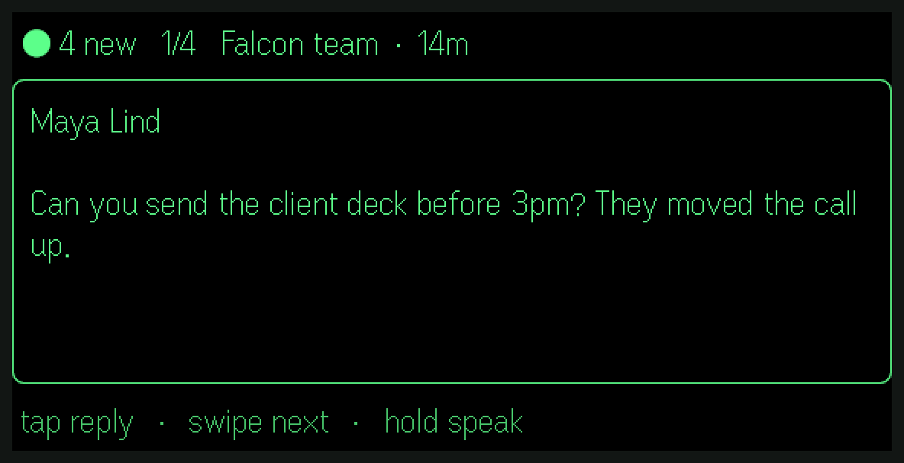 Inbox card | 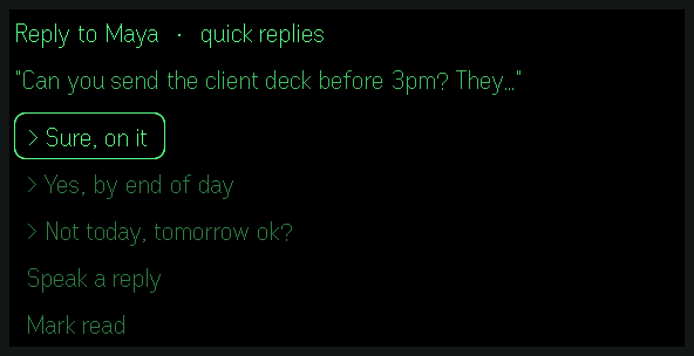 Tap: reply drafts |
| 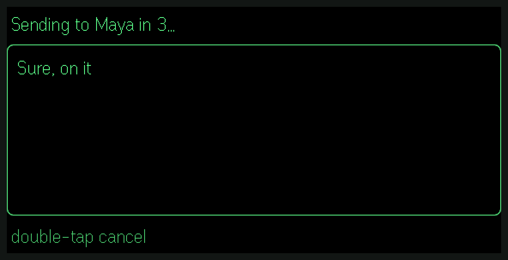 3 s to cancel | 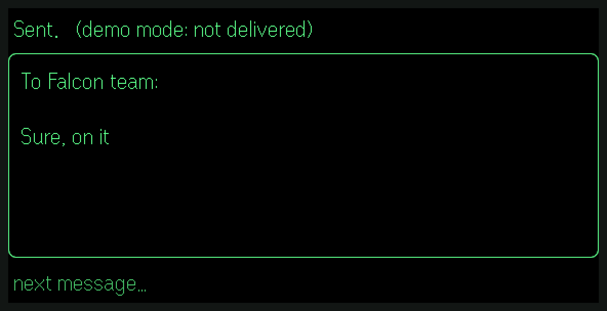 Sent, threaded in Telegram |
| 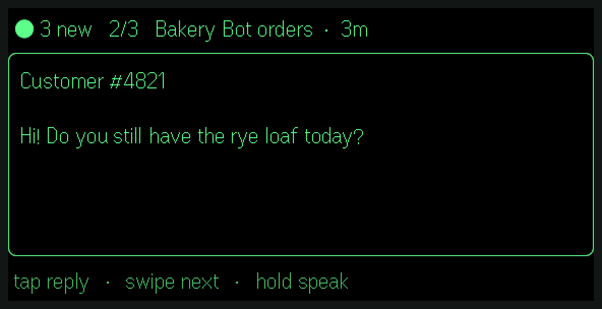 Swipe: a customer on the shop bot | 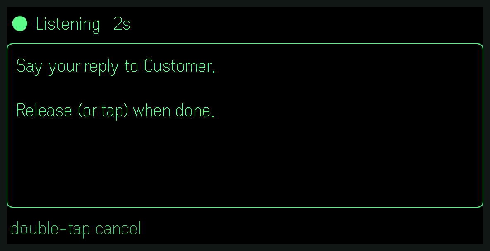 Hold: speak a reply |
| 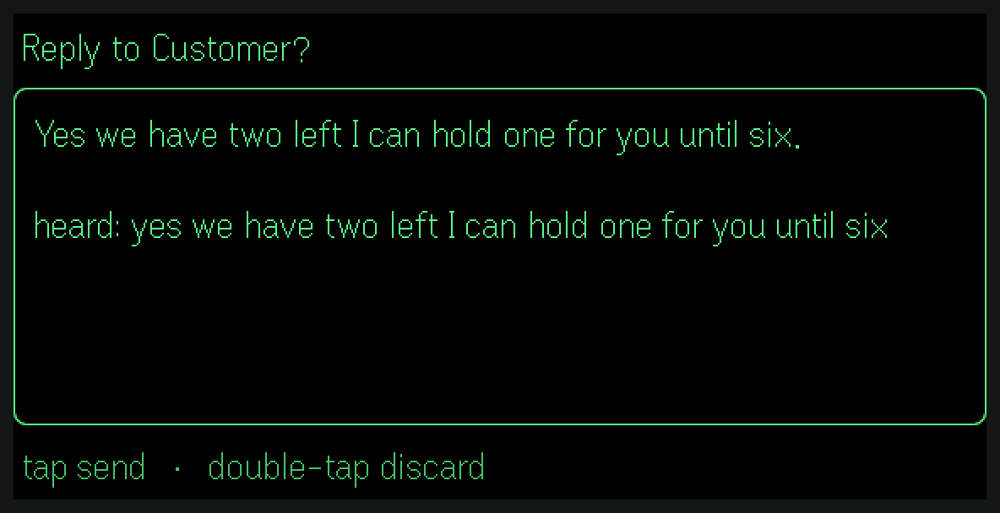 Cleaned-up transcript, tap to send | 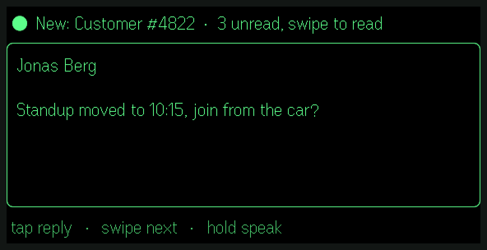 New message announced in the header |
| 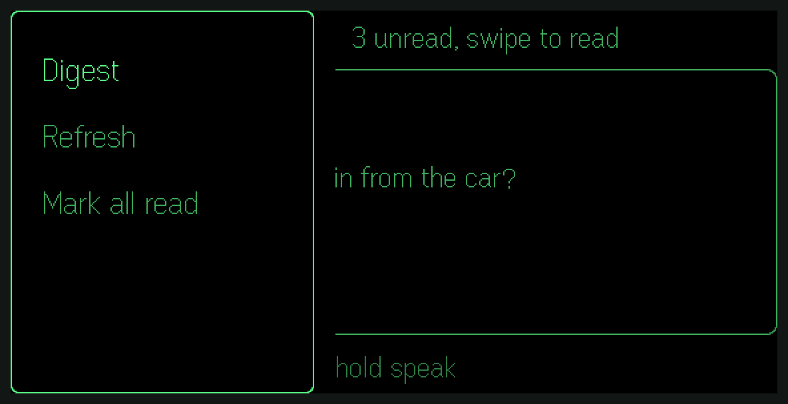 Contextual menu | 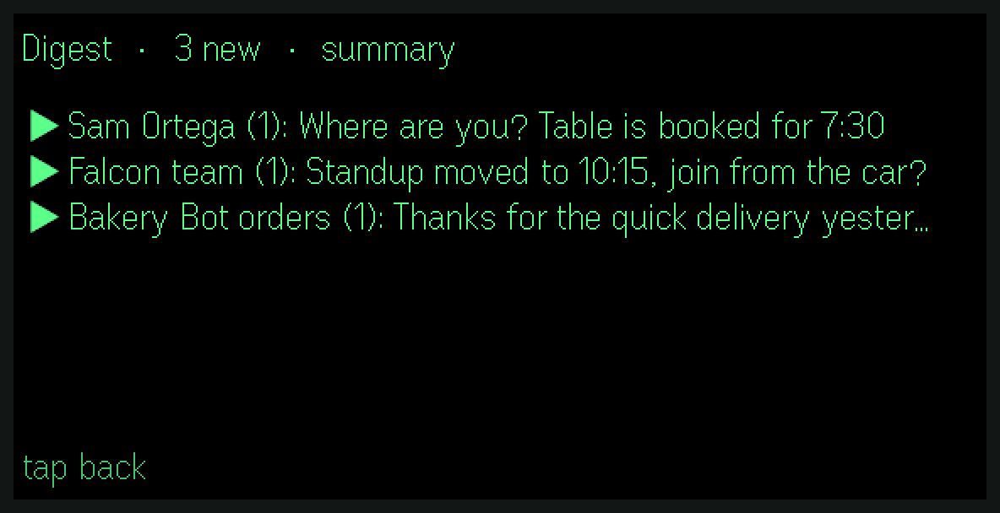 Digest of everything unread |
| 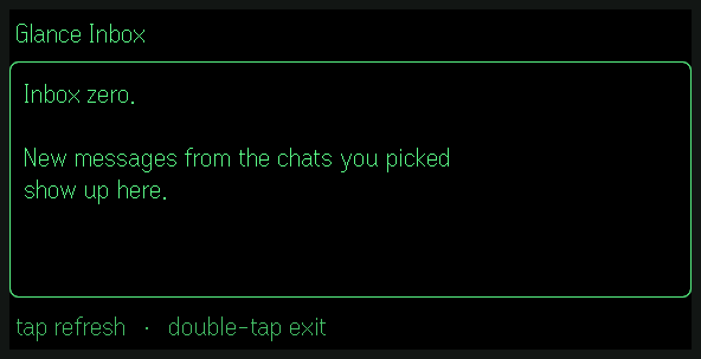 Inbox zero | 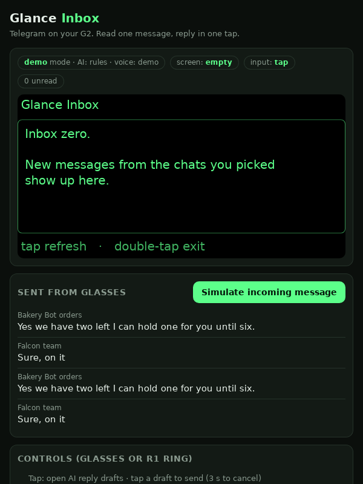 Phone companion page (mirror, sent log, demo button) |

## How it works

```
 Telegram Bot API                    Glance Inbox server (Node, server/)                G2 web app (src/, Even Hub SDK)
 ────────────────    getUpdates     ───────────────────────────────────    HTTPS      ────────────────────────────────
 your test bot   ─── long-poll ───▶  allowlist of picked chats              ◀─ poll ─  card / list / text containers
 DMs + groups    ◀── sendMessage ──  in-memory unread store                 ── JSON ─▶ tap · swipe · hold · menu
                     (threaded)      drafts / digest / polish:                         G2 mic PCM ─▶ /api/voice-reply
                                       Claude (ANTHROPIC_API_KEY)
                                       └─ fallback: local rules
                                     STT: any OpenAI-compatible
                                       /audio/transcriptions (STT_URL)
```

- **Glasses app** (`src/main.ts`): a small state machine over pages: card, replies, sending, sent, listening, confirm, digest, empty and error.
  - Layouts are pure functions (`src/screens.ts`), unit-tested against the SDK limits: 576 x 288 bounds, at most 8 containers, list items of 63 bytes or less, and menu labels of 32 bytes or less.
  - Input handling covers the SDK quirks: `CLICK_EVENT = 0` arrives as `undefined`, a list capture delivers `listEvent`, and long press arrives on `sysEvent`.
- **Server** (`server/`): plain `node:http` with no framework.
  - Telegram long-polling and an allowlist ("see new messages only from the chats you pick").
  - Replies are threaded with `reply_parameters`.
  - Messages live in memory only, never on disk.
  - API keys stay on the server and never ship in the `.ehpk`, as the hackathon rules require.
- **AI** (`server/llm.mjs`):
  - Claude via the official `@anthropic-ai/sdk`, with structured JSON output, low effort, an 8 s timeout and server-side refusal fallbacks.
  - Three prompts: reply drafts (with the last 6 messages of the chat as context), digest, and voice clean-up.
  - **Without a key, or on any error, it falls back to local rules** (`server/rules.mjs`), so the glasses never hang and the demo works offline.
- **Voice** (`server/stt.mjs`): G2 PCM (16 kHz s16le) is wrapped as WAV and sent to any OpenAI-compatible transcription endpoint, for example a local whisper.cpp server. Demo mode uses canned transcripts.

## Setup

Requirements: Node 22.13+.

```bash
npm install
cp .env.example .env        # optional, everything works without it (demo mode)

# three terminals
npm run server              # API on :8787 (demo mode with fictional messages if no bot token)
npm run dev                 # Vite on :5173
npm run sim                 # EvenHub simulator pointed at :5173 (automation API on :9898)
```

The simulator comes from `@evenrealities/evenhub-simulator`, which is a devDependency.
The official global install works too: `npm i -g @evenrealities/evenhub-cli @evenrealities/evenhub-simulator`.
`npm run sim:headless` runs it under `xvfb-run`, so no window opens. This is useful for CI and for `npm run capture`.

### Connect a real Telegram test bot

1. In Telegram, talk to **@BotFather**, then `/newbot`. Copy the token into `.env` as `TELEGRAM_BOT_TOKEN`.
2. `npm run server`, then send the bot a message, or add it to a test group. The server log prints each chat's ID.
3. Put the IDs you want on your glasses in `TELEGRAM_ALLOWED_CHAT_IDS=123,-100456`, then restart. Other chats are ignored.
4. Replies from the glasses arrive in Telegram as replies to the original message.

A bot sees direct messages to it, plus group messages where it is mentioned or when privacy mode is off in BotFather.

### Turn on Claude

Set `ANTHROPIC_API_KEY` (and optionally `ANTHROPIC_MODEL`, default `claude-opus-5-5`).
The header of the reply screen changes from "quick replies" to "AI drafts by Claude".

### Turn on real voice replies

Set `STT_URL` to an OpenAI-compatible `/v1/audio/transcriptions` endpoint (and `STT_API_KEY` if it needs one).
A local `whisper.cpp` server keeps audio on your own machine.

### On real G2 hardware

1. Host the server over HTTPS.
2. Set `VITE_API_BASE` to its URL and add the same origin to `permissions[network].whitelist` in `app.json`.
3. Optionally set `APP_TOKEN` and `VITE_APP_TOKEN` to the same random value.
4. Run `npm run pack`, which produces `glance-inbox.ehpk`. Or sideload the dev server with `npx evenhub qr --url http://<lan-ip>:5173`.

## Tests

```bash
npm test          # 12 tests: rules, store, Telegram mapping/allowlist/threading, HTTP API end-to-end, screen limits
npm run build     # tsc --noEmit + vite build
npm run capture   # drives the simulator: 13 screenshots, demo GIF, companion screenshot
```

## Safety and privacy

- **Only the chats you pick** reach the glasses (allowlist). Messages are held in memory and dropped on restart.
- **Nothing is sent without your action.** Drafts go out after a visible 3 s countdown that a double-tap cancels. Voice replies need an explicit tap after you read the transcript.
- **No secrets in the app package.** Tokens live in the server's `.env`. `.env` is git-ignored; only `.env.example` is committed.
- The AI is told to keep replies short and to invent no facts or commitments.
- The demo uses only fictional people and messages (`server/demo.mjs`). Demo replies are logged and never sent.
- The Claude API receives only the message being answered and up to 6 earlier messages from the same chat. It receives nothing when no key is set.

## API feature requests (optional deliverable)

1. **Even Hub SDK:** a way to show a short, glanceable alert while another app is in the foreground, so urgent messages can surface.
2. **Even Hub SDK:** in-place list item updates, so drafts can stream in without a full page rebuild.
3. **Even Hub SDK:** an on-device or SDK-provided speech-to-text option, so apps don't each need their own STT backend.
4. **Telegram Bot API:** an official "draft reply" or quick-reply suggestion surface for bots that act on a user's behalf.
5. **Even Hub simulator:** a scripted microphone input (WAV file), so voice flows can be tested headlessly.

## What existed before Nov 23, 2026

Nothing from this project. All code was written during the build week.

It uses these open-source packages:

- Even Hub SDK, CLI and simulator.
- `@anthropic-ai/sdk`.
- Vite and TypeScript.
- `pngjs` and `gifenc` (screenshot and GIF capture only).

## Project layout

```
app.json            Even Hub manifest (network + g2-microphone permissions)
index.html          Companion page in the Even app WebView
src/main.ts         Glasses controller (events, pages, polling, voice)
src/screens.ts      Pure layouts for 576 x 288
src/api.ts          Backend client
src/companion.ts    Phone-side mirror, sent log, demo button
server/             Node backend: Telegram, Claude, rules, STT, demo data
scripts/capture.mjs Simulator automation: screenshots + GIF
test/               node:test suites
docs/               Screenshots, demo GIF, demo script, BUIDL text
```

## License

MIT
